# Business Technology Architecture

How the website fits into the rest of the business, from a Google search to a paid, booked and recorded project, for a one- or two-person landscaping business in Broward County, FL.

> **Planning document only.** Nothing here changes the website. "Built" means it exists in this repo today; everything else is a recommendation. Prices were checked in October 2026 and are marked *(unverified)* where only third-party sources were available. Confirm on each vendor's pricing page before subscribing.

Related: [CUSTOMER_LEAD_FLOW.md](CUSTOMER_LEAD_FLOW.md) · [IMPLEMENTATION_ROADMAP.md](IMPLEMENTATION_ROADMAP.md)

---

## Executive summary

- **The website already covers the hardest part.** The inquiry form, validation, spam protection and owner email/SMS notifications are built and tested (`lib/inquiry/`, `netlify/functions/inquiry.mjs`). They only need accounts and keys.
- **Recommended stack:** Netlify, Resend, Gmail, Google Sheets, Google Calendar, Google Docs, Dropbox Sign, Stripe and QuickBooks Online. Most of it is free until the business has paying customers.
- **No paid automation platform at first.** At a few inquiries a week, Zapier or Make would cost more in fees and upkeep than the time they save. The automations worth having are native integrations, plus one small free script added later.
- **Running cost:**

  | Phase | Monthly cost |
  |---|---|
  | Phase 1 (launch) | $0–9, plus about $15/year for a domain |
  | Phase 2 (customer workflow) | about $0–25 |
  | Phase 3 (payments and books) | about $40–100, plus Stripe's per-payment fees |

- **System of record:**
  - Leads: Google Sheets
  - Customers, invoices and books: QuickBooks Online
  - Payments: Stripe
  - Signed contracts: Dropbox Sign, with PDF copies in Google Drive
  - Appointments: Google Calendar

---

## What exists today (verified in this repo)

| Capability | Status | Where |
|---|---|---|
| Static website (Home, Services & Projects, Plants, Contact) | ✅ Built | `src/templates/`, `scripts/build.mjs` |
| Local SEO basics: titles, descriptions, sitemap, LocalBusiness data | ✅ Built | `src/templates/layout.mjs` |
| Inquiry form with shared client/server validation | ✅ Built | `lib/inquiry/schema.mjs` |
| Spam protection: honeypot, fill-time check, rate limit, duplicate blocking | ✅ Built | `lib/inquiry/handler.mjs`, Netlify function config |
| Owner email notification (Resend REST API) | ⚙️ Built; needs `RESEND_API_KEY`, verified domain | `lib/inquiry/notify.mjs` |
| Owner SMS notification (Twilio REST API) | ⚙️ Built, optional; needs Twilio and carrier registration | `lib/inquiry/notify.mjs` |
| Hosting configuration | ⚙️ Ready for Netlify, not yet deployed | `netlify.toml` |
| Lead storage, CRM, scheduling, contracts, payments, accounting | ❌ Not built (by design) | Proposed below |

The site keeps no customer database. Each inquiry exists only in the owner's inbox, plus a text alert if SMS is enabled. That keeps the privacy risk low, and it's why lead tracking is the first gap to close.

---

## Architecture diagram

```mermaid
flowchart LR
  classDef built fill:#E8EEE4,stroke:#3E5E48,color:#1F3529
  classDef manual fill:#F6F2EA,stroke:#B8694C,color:#1F3529,stroke-dasharray:4 3
  classDef future fill:#FFFFFF,stroke:#7F9479,color:#56615A,stroke-dasharray:2 4
  classDef sor fill:#1F3529,stroke:#1F3529,color:#F6F2EA

  subgraph Acquire["1 · Acquisition"]
    GBP["Google Business Profile<br/>(free)"]:::manual
    SEO["Google Search /<br/>Maps results"]:::built
    REF["Referrals, yard signs,<br/>Nextdoor"]:::manual
  end

  subgraph Site["2 · Website (Netlify)"]
    WEB["Static site<br/>Home · Services · Plants · Contact"]:::built
    FORM["Inquiry form<br/>/contact/#inquiry"]:::built
    FN["Netlify Function<br/>/api/inquiry<br/>validate · spam · dedupe · rate-limit"]:::built
  end

  subgraph Notify["3 · Owner notification"]
    RESEND["Resend → owner inbox<br/>(email, primary)"]:::built
    TWILIO["Twilio → owner phone<br/>(SMS, optional)"]:::built
    GMAIL["Gmail<br/>labels + reply templates"]:::manual
  end

  subgraph Leads["4 · Lead tracking"]
    SHEET[("Google Sheets<br/>Lead tracker<br/>SYSTEM OF RECORD: leads")]:::sor
    GAS["Apps Script web app<br/>append row from function"]:::future
  end

  subgraph Book["5 · Consultation"]
    CAL["Google Calendar<br/>appointment schedule<br/>SYSTEM OF RECORD: appointments"]:::sor
  end

  subgraph Sell["6 · Estimate & contract"]
    DOCS["Google Docs<br/>proposal template → PDF"]:::manual
    SIGN["Dropbox Sign<br/>e-signature"]:::manual
    DRIVE[("Google Drive<br/>signed PDFs archive")]:::sor
  end

  subgraph Money["7 · Payments & accounting"]
    STRIPE[("Stripe<br/>Payment Links / Invoices<br/>SYSTEM OF RECORD: payments")]:::sor
    QBO[("QuickBooks Online<br/>SYSTEM OF RECORD: customers,<br/>invoices, books")]:::sor
    SYNC["Stripe→QBO connector<br/>(Synder / PayTraQer)"]:::future
  end

  subgraph Care["8 · Follow-up"]
    FOLLOW["Gmail templates +<br/>Calendar reminders"]:::manual
    REVIEW["Google review request<br/>(link already supported on site)"]:::manual
  end

  GBP --> SEO --> WEB
  REF --> WEB
  WEB --> FORM -->|"POST JSON"| FN
  FN -->|"email (must succeed)"| RESEND --> GMAIL
  FN -->|"SMS (best effort)"| TWILIO
  FN -. "Phase 2: append lead" .-> GAS -.-> SHEET
  GMAIL -->|"Phase 1: owner logs lead (≈1 min)"| SHEET
  GMAIL -->|"reply with booking link"| CAL
  CAL -->|"site visit"| DOCS --> SIGN --> DRIVE
  SIGN -->|"signed → send deposit link"| STRIPE
  STRIPE -->|"Phase 3 start: owner records payout"| QBO
  STRIPE -. "Phase 3 at volume" .-> SYNC -.-> QBO
  QBO --> FOLLOW --> REVIEW
  SHEET -. "status updates" .- CAL
```

**Key:** solid green = built and automated · dashed tan = manual owner step or simple tool · dotted white = proposed future automation · dark = system of record.

---

## Systems of record

Each kind of record lives in exactly one place. Everything else links to it or copies from it.

| Data | System of record | Copies elsewhere | Why |
|---|---|---|---|
| Inquiries / leads | **Google Sheets** "Lead tracker" | Original email in Gmail | Free, shareable, easy to sort; no CRM to learn |
| Appointments | **Google Calendar** | Row in Lead tracker | Booking page and phone reminders built in |
| Proposals and signed contracts | **Dropbox Sign** (audit trail) + **Google Drive** (PDF archive) | Link in Lead tracker | Legally useful audit trail; Drive keeps a permanent copy |
| Payments | **Stripe** | Recorded in QBO | Stripe is where money actually moves |
| Customers, invoices, expenses, taxes | **QuickBooks Online** | Customer name in Stripe | The books your accountant will use |

A customer becomes a QBO customer only after signing. Leads that never sign stay in the Sheet, which keeps the books clean.

---

## Recommended tool per category

| Category | Recommendation | Why it's the best value | Main alternative considered |
|---|---|---|---|
| Lead capture | **Existing website form** (built) | Already built and tested; no form-builder fees | Google Forms (less professional, no spam controls) |
| Notifications | **Resend email** (built) + Gmail app push on the owner's phone | Free tier: 100/day, about 3,000/month; a phone push from Gmail does the same job as SMS for free | Twilio SMS (built, but needs carrier registration and monthly fees; add only if email alerts get missed) |
| Lead tracking | **Google Sheets** Lead tracker | Free, needs no training, easy to move to a CRM later | HubSpot free CRM (more than needed now); Jobber (see consolidation) |
| Scheduling | **Google Calendar appointment schedule** | A free personal account gets one booking page with unlimited bookings; it lives where Robert already works | Cal.com free plan (multiple appointment types, more setup); Calendly free plan allows only one appointment type |
| Automation | **None at first**, then **Google Apps Script** (free) and native integrations | Avoids per-task fees and fragile chains of connected apps | Zapier and Make free tiers have small task limits; n8n needs a server to run and maintain |
| Estimates and contracts | **Google Docs template → PDF → Dropbox Sign** | Docs is free; Dropbox Sign's free plan covers 3 signature requests a month *(unverified)*, enough at launch | QuickBooks estimates (handy once QBO is in use; check whether online acceptance counts as a signature) |
| Payments | **Stripe** Payment Links and Invoices | No monthly fee; cards 2.9% + 30¢, bank transfer (ACH) 0.8% capped at $5 *(unverified)* | QuickBooks Payments (built into QBO, so no sync needed; see consolidation) |
| Accounting | **QuickBooks Online Simple Start** | One user, invoices, expense tracking, bank feeds; about $38/month list price *(unverified, frequently discounted)* | Wave (free, but more work at tax time if your accountant uses QBO) |
| Follow-up | **Gmail templates + Calendar reminders**, later Apps Script | Free; Robert's personal voice stays intact | Email-marketing tools (not needed) |
| Hosting | **Netlify free plan** | The site and inquiry function already target Netlify; the free plan's 300 monthly credits cover a low-traffic site, but each production deploy uses some *(unverified)* | Netlify Personal plan, $9/month, if deploys run out of credits |

### Notes on choices

- **SMS:** the code is ready, but US carriers require A2P 10DLC registration: a one-time fee of about $4.50 plus a monthly campaign fee of about $2–10 *(unverified)*, a phone number, and per-message charges. Gmail's phone notifications cover the same need for free. Turn SMS on only if alerts get missed.
- **E-signatures** are generally valid under the federal ESIGN Act and Florida's Uniform Electronic Transaction Act (Fla. Stat. §668.50). Have a Florida attorney review the contract template once (terms, deposits, change orders, cancellations). That's the most valuable one-time cost in this plan.
- **Stripe Invoicing** may carry a per-paid-invoice fee on top of card fees; I couldn't confirm the current rate *(unverified)*. Payment Links don't use Invoicing and avoid that fee, which suits deposits.

---

## Integration requirements

| Integration | Type | Requires | Status |
|---|---|---|---|
| Website → Resend | REST API from the Netlify function | Resend account, verified domain, 3 Netlify environment variables | Built |
| Website → Twilio | REST API | Twilio account, phone number, A2P 10DLC registration, 4 environment variables | Built, optional |
| Website → Google Sheets | Apps Script web app (free) called from the function | Apps Script deployment URL + shared secret in Netlify environment variables; about 40 lines of code | Proposed (Phase 2) |
| Google Calendar ↔ Gmail | Native | Same Google account | Native |
| Dropbox Sign ↔ Google Drive | Native Drive integration or manual download | Dropbox Sign account | Native or manual |
| Stripe → QBO | Third-party connector (Synder, PayTraQer, Acodei), about $15–50/month *(unverified)* | QBO + Stripe accounts | Proposed (Phase 3, only at volume) |
| Site → Google review link | Already supported in `content/reviews.json` | A Google Business Profile review link | Built |

---

## Error handling, duplicates, security, reconciliation

| Concern | How it's handled |
|---|---|
| **Inquiry delivery failure** | Built. The visitor sees success only if the email provider accepts the message; otherwise an honest error appears and their answers stay filled in. The function logs show which channel failed (never customer details). |
| **Duplicate inquiries** | Built. Identical submissions within 15 minutes are delivered once. In the Sheet, sort by email or phone before adding a row. The Phase 2 script should skip a row if the same email or phone appears in the last 7 days. |
| **Spam** | Built. A hidden trap field, a minimum fill time, an in-app rate limit and Netlify's rate limit (10 per minute per IP address). |
| **Customer data** | Stored in Gmail, Sheets and QBO only. Sharing on the Sheet is limited to Robert's account. All accounts use two-factor authentication. Secrets live only in Netlify environment variables. Delete old leads that never became customers once a year, as the privacy notice promises. |
| **Payment security** | Card details never touch the website or the Sheet; Stripe-hosted pages handle them. |
| **Payment reconciliation** | Stripe pays out in batches with fees already taken out. Record each payout in QBO through a "Stripe clearing" account: the full payment amount, Stripe fees as an expense, and the net amount as the bank deposit. Write the Stripe payment ID in the QBO memo, and match monthly against the bank statement. A connector automates this once volume justifies it. |
| **Deposits** | Record deposits as "customer deposits" (money owed until the work is done) in QBO, not income, until the job is complete. Confirm the treatment with an accountant. |

---

## Viable alternatives compared

| Approach | Monthly cost | Pros | Cons | Verdict |
|---|---|---|---|---|
| **Recommended: Google + Dropbox Sign + Stripe + QBO** | $0 → about $40–100 | Pay only as each piece is needed; Robert already knows the Google tools; easy for an accountant | Several logins; a few manual hand-offs | ✅ Best fit for 1–2 people starting out |
| **All-in-one field service app (Jobber)** | Core plan about $39–49 *(unverified)*; QuickBooks sync needs the Connect plan, about $129+ *(unverified)* | One app for quotes, scheduling, invoices and payments | Paying for features before having customers; QBO sync is expensive; less control over the brand voice | Revisit if Robert ends up running 10+ recurring jobs a week |
| **QuickBooks-centric (QBO estimates + QuickBooks Payments)** | QBO only | Payments land in the books automatically; no sync tool | Ties payments to Intuit's fees; Stripe was requested | Good consolidation option (see roadmap) |
| **Zapier or Make-driven automation** | $0–30+ | Visual tools, many connectors | Task limits, chains of steps that break, monthly fees for little value at low volume | ❌ Not now |

---

## Risks

| Risk | Impact | Mitigation |
|---|---|---|
| Email isn't configured at launch | Lost leads; the form shows an error | Launch blocker in the README; send a live test inquiry before going public |
| Free-tier limits change (Netlify credits, Resend, Dropbox Sign) | Unexpected outages or upgrade prompts | Check usage monthly; the paid tiers are small ($9–20) |
| Too many tools for one person | Missed follow-ups | Add a tool only when its phase trigger is met; the Lead tracker's "Next step" column is the daily to-do list |
| Contract terms not legally reviewed | Disputes over deposits or scope | One-time attorney review of the proposal and contract template |
| Manual payout recording errors | Books don't match the bank | Stripe clearing account, monthly reconciliation, connector at volume |
| Customer data scattered across tools | Privacy and cleanup burden | The systems-of-record table above; yearly cleanup of stale leads |

---

## Recommended lean technology stack

The smallest set that runs the business well:

| # | Tool | Job | Cost |
|---|---|---|---|
| 1 | **Website + Netlify + Resend** (built) | Get found, capture inquiries, alert Robert | $0, plus about $15/year domain |
| 2 | **Gmail + Google Calendar + Google Sheets + Google Docs** | Reply, book consultations, track leads, write proposals | $0 (or about $7–8.40/month for Google Workspace business email *(unverified)*) |
| 3 | **Dropbox Sign** | Signed contracts with an audit trail | $0 for up to 3 signature requests a month, then about $15/month *(unverified)* |
| 4 | **Stripe** | Deposits and final payments | Per-payment fees only |
| 5 | **QuickBooks Online Simple Start** | Customers, invoices, expenses, taxes | About $38/month *(unverified)* |

Five tools, all but two free. Everything else is optional until the business proves it needs it.

---

## Sources (checked October 2026)

- Netlify pricing and credits: [Netlify pricing and limits overview](https://netli.fyi/blog/netlify-pricing-and-limits), [Hackceleration](https://www.hackceleration.com/labs/netlify-pricing)
- Resend free tier: [Resend pricing](https://resend.com/pricing.md), [Resend docs](https://resend.com/docs/knowledge-base/what-is-resend-pricing.md)
- Stripe fees: [Swipesum guide](https://swipesum.com/insights/guide-to-stripe-fees-rates-for-2025), [Orb breakdown](https://www.withorb.com/blog/stripe-pricing)
- QuickBooks Online pricing: [NerdWallet](https://www.nerdwallet.com/article/small-business/business-software/how-much-does-quickbooks-cost), [Dancing Numbers](https://www.dancingnumbers.com/how-much-is-quickbooks-online-per-month/)
- Dropbox Sign plans: [Signeasy summary](https://signeasy.com/blog/business/dropbox-sign-pricing), [Jotform guide](https://www.jotform.com/products/sign/hellosign-pricing/)
- Twilio A2P 10DLC fees: [Twilio support](https://support.twilio.com/hc/en-us/articles/1260803965530), [Twilio docs](https://www.twilio.com/docs/trust-hub/registrations/a2p-10dlc-campaign)
- Stripe ↔ QuickBooks connectors: [Stripe accounting integrations](https://edge-docs.stripe.com/stripe-apps/embedded-apps/accounting-integrations), [SaasAnt PayTraQer](https://saasant.com/blog/mastering-stripe-and-quickbooks-integration-a-step-by-step-guide)
- Scheduling: [Google Calendar free booking pages (9to5Google)](https://9to5google.com/2023/06/21/google-calendar-free-booking-pages/), [Cal.com](https://cal.com/blog/calendly-alternatives-for-google-calendar), [Calendly free plan limits (Zeeg)](https://zeeg.me/en/blog/post/calendly-free-plan-limitations)
- Google Workspace pricing: [9to5Google](https://9to5google.com/2025/01/15/google-workspace-price-increase-2025/)
- Jobber pricing: [OneCrew](https://www.getonecrew.com/post/jobber-pricing), [ERP Research](https://erpresearch.com/erp-add-ons/field-service/jobber/pricing)
