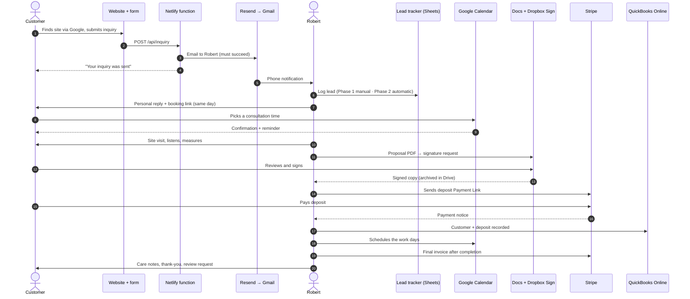
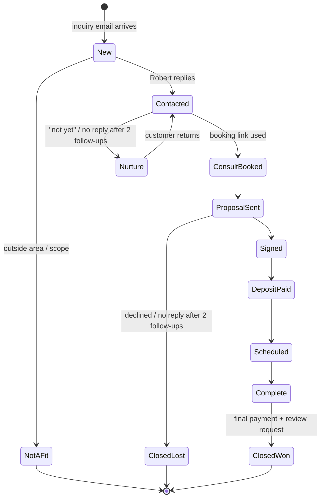

# Customer Journey & Lead Flow

Every stage from a Google search to a follow-up after the job: who does what, which tool is involved, what information moves between tools, and what's automated. Tools and costs are in [BUSINESS_TECH_ARCHITECTURE.md](BUSINESS_TECH_ARCHITECTURE.md); phases are in [IMPLEMENTATION_ROADMAP.md](IMPLEMENTATION_ROADMAP.md).

**Legend:** ✅ built · ⚙️ needs setup · 🔜 proposed · ✋ stays manual on purpose

---

## Journey at a glance

---

## Stage-by-stage

### 1. Local SEO / Google Search
| | |
|---|---|
| **Customer** | Searches "landscaping Broward", "tropical landscape design Plantation", etc.; sees the Google Business Profile or the site |
| **Robert** | ✋ Sets up and verifies the Google Business Profile, adds real project photos, answers reviews |
| **Software** | Google Business Profile (free), website SEO basics ✅ |
| **Data** | None collected |
| **Automation** | ✅ Sitemap, page titles and LocalBusiness data are generated at build time |
| **Stays manual** | Profile posts, photos, responding to reviews (personal voice) |
| **Outcome** | Visitor lands on the Home or Services page |

### 2. Website visit
| | |
|---|---|
| **Customer** | Reads Robert's story, browses services, design ideas and the plant guide |
| **Robert** | Nothing |
| **Software** | Static site on Netlify ✅ |
| **Data** | None (no analytics trackers, as the privacy notice states) |
| **Outcome** | Clicks "Start Your Project" or "Tell Me About Your Project" |

### 3. Project inquiry
| | |
|---|---|
| **Customer** | Fills out the form: name, email or phone, location, project type, budget (optional), timeframe (optional), description, preferred contact method |
| **Software** | Form + `/api/inquiry` function ✅ |
| **Data** | The fields above plus a timestamp. Nothing is stored on the website. |
| **Automation** | ✅ Validation, spam trap, rate limiting, duplicate blocking, honest success or failure message |
| **Trigger** | Form submit, which calls the function |
| **Outcome** | Email (and optionally a text) goes to Robert; the visitor sees a confirmation |

### 4. Owner notification
| | |
|---|---|
| **Robert** | Gets a Gmail push on his phone; opens a formatted email; Reply goes straight to the customer |
| **Software** | Resend ⚙️ (needs key + domain), Twilio SMS ⚙️ optional |
| **Automation** | ✅ Formatting, reply-to header, delivery check · 🔜 Gmail filter auto-labels "Lead / New" (subject starts with "New project inquiry") |
| **Failure path** | If email fails, the visitor is told it wasn't sent; the function log shows which channel failed |

### 5. Lead qualification
| | |
|---|---|
| **Robert** | ✋ Reads the inquiry and decides: good fit / need more info / not a fit. Replies personally within 1 business day (a goal, not a site promise). |
| **Software** | Gmail reply templates, Lead tracker (Sheets) |
| **Data into the Sheet** | Date, name, contact, city, project type, budget, timeframe, status, next step, next-step date |
| **Automation** | Phase 1: ✋ copy key fields into the Sheet (about 1 min) · Phase 2: 🔜 the function appends the row automatically through an Apps Script web app |
| **Stays manual** | The fit decision and the first reply. This is the brand. |
| **Outcome** | Status becomes **Contacted**; good fits get the booking link |

### 6. Consultation scheduling
| | |
|---|---|
| **Customer** | Picks a time on Robert's booking page |
| **Software** | Google Calendar appointment schedule (free, one booking page) |
| **Automation** | Native: confirmation email, event on both calendars. Email reminders need a paid Google plan; on the free plan, Robert sends a quick reminder text or email the day before (✋, or a 🔜 Apps Script reminder). |
| **Data** | Name, email, address/notes from the booking form |
| **Outcome** | Status becomes **Consult booked**; site visit happens |

### 7. Estimate / proposal
| | |
|---|---|
| **Robert** | ✋ Visits, listens, measures, photographs; writes the proposal from a Google Docs template (scope, plant list, price, deposit, timeline estimate) |
| **Software** | Google Docs → PDF; later, optionally QBO estimates |
| **Automation** | Template only. Creative and pricing work stays manual. |
| **Outcome** | Status becomes **Proposal sent** with a follow-up date 3–5 days out |

### 8. Contract & e-signature
| | |
|---|---|
| **Customer** | Reviews and signs on a phone or computer |
| **Software** | Dropbox Sign (free for up to 3 requests a month *(unverified)*) |
| **Automation** | Native: signer reminders, audit trail, completed-copy email to both parties. 🔜 Save to Google Drive through the native integration or by hand. |
| **Data** | Signed PDF + audit certificate; Drive link added to the Sheet |
| **Outcome** | Status becomes **Signed** |

### 9. Stripe deposit / payment
| | |
|---|---|
| **Customer** | Pays the deposit through a Stripe-hosted link (card or bank transfer) |
| **Robert** | ✋ Creates a Payment Link or Invoice for the deposit amount and sends it |
| **Software** | Stripe |
| **Automation** | Native: receipt to the customer, payment notification to Robert |
| **Data** | Payment ID, amount, fee, payout date (stays in Stripe; no card data elsewhere) |
| **Outcome** | Status becomes **Deposit paid** |

### 10. QuickBooks accounting
| | |
|---|---|
| **Robert** | Creates the QBO customer at signing. Records each Stripe payout through the Stripe clearing account (gross amount, fees, net deposit). |
| **Automation** | ✋ at low volume (about 5 minutes per payout) · 🔜 connector at volume (see the roadmap) |
| **Outcome** | Books match the bank; deposits are held as customer deposits until the work is done |

### 11. Project scheduling
| | |
|---|---|
| **Robert** | ✋ Blocks work days in Google Calendar, invites the customer, orders plants and materials |
| **Automation** | Calendar invite and reminders (native) |
| **Outcome** | Status becomes **Scheduled**, then **In progress**, then **Complete** |

### 12. Customer follow-up
| | |
|---|---|
| **Robert** | Sends the final invoice (Stripe or QBO), care notes for new plants, a thank-you, a review request, and a check-in a few weeks later |
| **Software** | Gmail templates, Google review link (shown on the site once added to `content/reviews.json`) |
| **Automation** | 🔜 An Apps Script time trigger emails Robert a daily list of overdue "next step" rows |
| **Stays manual** | Thank-you and review request: personal, short, in Robert's voice |
| **Outcome** | Status becomes **Closed – won**; reviews are added to the site only with permission |

---

## Lead lifecycle (Lead tracker statuses)

### Suggested Lead tracker columns

`Received` · `Name` · `Email` · `Phone` · `Preferred contact` · `City/ZIP` · `Project type` · `Budget` · `Timeframe` · `Status` · `Next step` · `Next step date` · `Consult date` · `Proposal $` · `Contract link` · `Deposit paid` · `QBO customer?` · `Source` (Google, referral, sign…) · `Notes`

Sort by `Next step date` every morning; that's the to-do list.

---

## Automation triggers summary

| Trigger | Action | Tool | Status |
|---|---|---|---|
| Form submitted | Validate, block spam and duplicates, email (and SMS) Robert | Netlify function | ✅ Built |
| Inquiry email arrives | Label "Lead / New" | Gmail filter | 🔜 Phase 1, 5-minute setup |
| Form submitted | Append a row to the Lead tracker (skip duplicates seen in the last 7 days) | Function → Apps Script | 🔜 Phase 2 |
| Consultation booked | Confirmation + calendar event | Google Calendar | Native |
| Daily at 7am | Email Robert the leads whose next step is due or overdue | Apps Script time trigger | 🔜 Phase 2 |
| Signature request sent | Reminders to the signer | Dropbox Sign | Native |
| Contract signed | Completed copy to both parties, saved to Drive | Dropbox Sign | Native / 🔜 |
| Payment received | Receipt + notification | Stripe | Native |
| Stripe payout | Record in QBO | Manual → connector | ✋ / 🔜 Phase 3 |

---

## What stays manual, and why

- **The first reply, qualification, site visit, design and pricing.** Personal attention is the product. Automating these would undercut the brand ([docs/brand-voice.md](docs/brand-voice.md)).
- **Sending contracts and deposit links.** A few a month take seconds each; a mistake there costs more than the automation would save.
- **Thank-yous and review requests.** Short personal notes in Robert's voice work better than drip campaigns.
