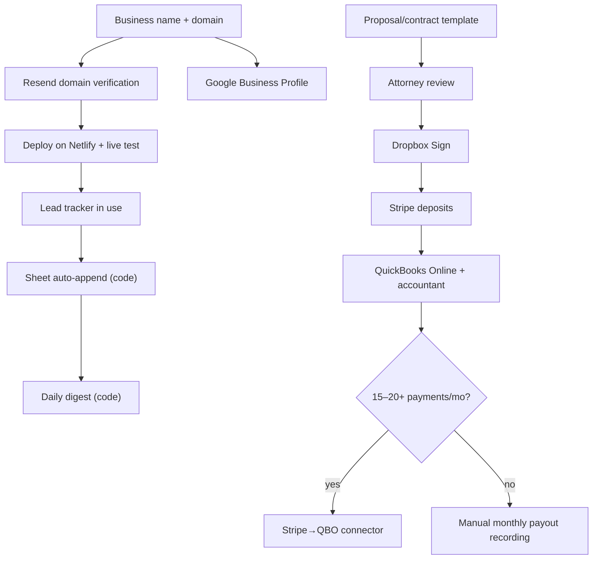

# Implementation Roadmap

Three phases, each started by **actual business activity**, not a calendar date. Architecture: [BUSINESS_TECH_ARCHITECTURE.md](BUSINESS_TECH_ARCHITECTURE.md). Workflow: [CUSTOMER_LEAD_FLOW.md](CUSTOMER_LEAD_FLOW.md).

> Costs checked October 2026; *(unverified)* = third-party sources only. "Effort" means Robert's setup time unless it says code.

---

## Phase overview

| Phase | Start when… | Monthly cost | Setup effort |
|---|---|---|---|
| **1 · Launch / MVP** | Now | **$0–9**, plus about $15/year domain | About 1 day of account setup + 1 Claude Code session |
| **2 · Customer workflow** | About 3+ inquiries a week, **or** a follow-up slips through the cracks, **or** the first proposal is ready to send | **About $0–25** | 2–4 hours + 1 code session (Sheet append) |
| **3 · Business operations** | First signed job needing a deposit (Stripe + QBO basics); connector at about 15–20+ Stripe payments a month or when payout recording takes over an hour a month | **About $40–100** + payment fees | Half a day, plus the accountant's input |

---

## Phase 1 — Launch / MVP

**Goal:** get found, capture every inquiry, never miss one.

| # | Task | Owner | Depends on | Effort | Cost |
|---|---|---|---|---|---|
| 1.1 | Choose the final business name, register it on Sunbiz, buy the domain | Robert | — | 1–2 h | About $15/year domain; Sunbiz fees vary |
| 1.2 | Update `content/site.json` and `content/owner.json` (name, email, phone, photo) | Robert / Claude Code | 1.1 | 30 min | $0 |
| 1.3 | Create a Resend account, verify the domain, add 3 environment variables in Netlify | Robert | 1.1 | 1 h | $0 (100/day free) |
| 1.4 | Merge PR #1, deploy on Netlify, connect the domain and HTTPS | Robert / Claude Code | 1.2, 1.3 | 1 h | $0 (free plan) |
| 1.5 | Send a live test inquiry; confirm the email and Reply work | Robert | 1.4 | 10 min | $0 |
| 1.6 | Set up and verify the Google Business Profile with the same name, phone and service area as the site | Robert | 1.1 | 1–2 h, plus verification wait | $0 |
| 1.7 | Gmail: filter for "New project inquiry" → label "Lead/New"; 3 reply templates; phone notifications on | Robert | 1.5 | 20 min | $0 |
| 1.8 | Create the Lead tracker Sheet (columns in CUSTOMER_LEAD_FLOW.md) | Robert | — | 20 min | $0 |
| 1.9 | Turn on two-factor authentication for Google, Netlify, Resend and GitHub | Robert | — | 20 min | $0 |
| 1.10 | *(Optional)* Google Workspace for a business mailbox | Robert | 1.1 | 1 h | About $7–8.40/user/month *(unverified)* |
| 1.11 | *(Optional, only if alerts get missed)* Twilio SMS + A2P registration | Robert | 1.4 | 1–2 h, plus registration wait | About $4.50 one-time + about $2–10/month + about $1.15/month number + per-message fees *(unverified)* |

**Exit criteria:** live site, test inquiry received, Business Profile verified, Sheet in daily use.

---

## Phase 2 — Customer workflow automation

**Start when** inquiries reach about 3 or more a week, a lead gets missed, or the first proposal is ready.

| # | Task | Owner | Depends on | Effort | Cost |
|---|---|---|---|---|---|
| 2.1 | Google Calendar appointment schedule for a "Garden consultation (45 min)"; add the link to the reply template | Robert | Phase 1 | 30 min | $0 (one booking page on a free account) |
| 2.2 | **Code:** the Netlify function appends each inquiry to the Sheet through an Apps Script web app (shared secret, skip duplicates, failures never block the email) | Claude Code | 1.8 | 1 session; about 40 lines + tests | $0 |
| 2.3 | **Code:** Apps Script daily digest email listing due or overdue next steps | Claude Code | 2.2 | Small | $0 |
| 2.4 | Proposal + contract template in Google Docs (scope, plant list, price, deposit %, change orders, cancellation, warranty language) | Robert | — | 2–3 h | $0 |
| 2.5 | **One-time attorney review** of the contract template (Florida) | Robert | 2.4 | — | Varies; often a few hundred dollars *(estimate)* |
| 2.6 | Dropbox Sign account; send contracts from the template | Robert | 2.4 | 20 min | $0 for up to 3/month, then about $15/month *(unverified)* |
| 2.7 | *(If more than one consultation type is needed)* switch scheduling to the Cal.com free plan | Robert | 2.1 | 1 h | $0 |

**Exit criteria:** every lead lands in the Sheet automatically; proposals go out on a consistent template; contracts are signed electronically.

---

## Phase 3 — Business operations integration

**Start the basics** at the first signed job that needs a deposit. **Add automation** only when volume justifies it.

| # | Task | Owner | Depends on | Effort | Cost |
|---|---|---|---|---|---|
| 3.1 | Stripe account (business details, bank account); a deposit Payment Link workflow | Robert | Phase 2 | 1 h | No monthly fee; cards 2.9% + 30¢, ACH 0.8% capped at $5 *(unverified)* |
| 3.2 | QuickBooks Online Simple Start; chart of accounts with an accountant (Stripe clearing, customer deposits, materials, plants) | Robert + accountant | 3.1 | 2–3 h | About $38/month list price *(unverified; promotions common)* |
| 3.3 | Monthly routine: record Stripe payouts in QBO, reconcile with the bank | Robert | 3.2 | About 5 min per payout | $0 |
| 3.4 | Final invoices from Stripe or QBO; care-notes email template | Robert | 3.1 | 30 min | Stripe Invoicing may add a per-invoice fee *(unverified)* |
| 3.5 | **When payout recording takes over an hour a month or there are 15–20+ payments a month:** a Stripe→QBO connector (Synder, PayTraQer or Acodei) | Robert | 3.2 | 1–2 h | About $15–50/month *(unverified)* |
| 3.6 | Block project days in Calendar; plants and materials checklist | Robert | — | Ongoing | $0 |
| 3.7 | Review requests: add the Google review link to `content/reviews.json`; add real reviews with permission | Robert / Claude Code | 1.6 | 15 min | $0 |
| 3.8 | **Code (optional):** Apps Script follow-up reminders for check-ins 2–4 weeks after completion | Claude Code | 2.2 | Small | $0 |

**Exit criteria:** deposits collected online, books reconciled monthly, every finished job gets a thank-you and a review request.

---

## Financial comparison

| Tool | Purpose | Monthly cost | Transaction fees | Automation capability | Complexity |
|---|---|---|---|---|---|
| Netlify | Hosting + inquiry function | $0 (300 credits); $9 Personal plan if deploys exhaust credits *(unverified)* | — | Serverless functions, rate limiting | Low (configured) |
| Resend | Inquiry emails | $0 (100/day, about 3,000/month); $20 Pro | — | REST API (built) | Low (built) |
| Twilio *(optional)* | SMS alerts | About $1.15 number + about $2–10 campaign *(unverified)* | About $0.008+ per message plus carrier fees *(unverified)* | REST API (built) | Medium (carrier registration) |
| Gmail / Calendar / Sheets / Docs | Email, booking, lead tracking, proposals | $0, or about $7–8.40 Workspace *(unverified)* | — | Filters, Apps Script, native booking | Low |
| Google Business Profile | Local SEO, reviews | $0 | — | — | Low |
| Dropbox Sign | E-signatures | $0 (3 requests/month) → about $15 *(unverified)* | — | Reminders, audit trail, Drive | Low |
| Stripe | Payments | $0 | Cards 2.9% + 30¢; ACH 0.8% (max $5); disputes $15 *(unverified)* | Payment Links, invoices, receipts | Low |
| QuickBooks Online Simple Start | Accounting | About $38 *(unverified)* | — | Bank feeds, invoices | Medium (accountant setup) |
| Stripe→QBO connector *(at volume)* | Payout sync | About $15–50 *(unverified)* | — | Automatic fee and payout matching | Low–Medium |
| Zapier / Make *(not recommended now)* | General automation | $0 with small task limits; paid tiers about $10–30+ | — | High | Medium (fragile chains) |

### Estimated monthly operating cost

| | Low | Typical | Notes |
|---|---|---|---|
| Phase 1 | $0 | $0–9 | Workspace mailbox optional; domain about $15/year |
| Phase 2 | $0 | $0–25 | Dropbox Sign paid tier only above 3 contracts a month |
| Phase 3 | About $38 | About $55–100 | QBO plus optional Workspace, Dropbox Sign, connector; plus Stripe fees on revenue |

**Payment fee example (illustrative):** a $3,000 job paid by card costs about $87.30 in Stripe fees (2.9% + 30¢); paid by ACH bank transfer, about $5 (capped). Offering ACH for larger payments is the biggest single cost lever.

### One-time costs
- Domain (about $15/year), Sunbiz registration (state fees vary), attorney contract review (varies), optional A2P SMS registration (about $4.50 plus campaign vetting fees *(unverified)*), optional accountant setup session.

### Free-tier limits to watch
- **Netlify:** 300 credits a month shared by deploys, bandwidth and function compute; when credits run out, builds stop until the next cycle *(unverified per-unit rates)*.
- **Resend:** 100 emails a day.
- **Dropbox Sign:** 3 signature requests a month.
- **Google Calendar (free account):** one booking page; automated reminder emails need a paid Workspace plan.
- **Zapier / Make free tiers:** small monthly task limits, which is a reason to avoid depending on them.

### Hidden costs
- Stripe→QBO sync isn't free: either about 5 minutes per payout by hand or a $15–50/month connector.
- Jobber's QuickBooks sync requires a much pricier plan than its entry tier *(unverified)*.
- SMS carrier registration fees and per-message carrier charges.
- Time spent maintaining chains of connected apps (Zapier/Make) when a connected app changes.

### Consolidation opportunities
1. **QuickBooks Payments instead of Stripe:** payments land in the books automatically, so no connector is needed. Compare fees with Stripe at that point; keep Stripe if online checkout flexibility matters more.
2. **QBO estimates instead of Google Docs proposals:** once QBO is in use. Check whether online acceptance meets the signature needs (Dropbox Sign stays the safer legal record).
3. **Google Workspace** adds a business mailbox and calendar reminder features in one subscription.
4. **All-in-one field service app (Jobber or similar):** only if recurring maintenance work grows enough that scheduling and invoicing dominate the week.

### Manual work eliminated (estimates, not promises)
| Automation | Replaces | Rough time saved |
|---|---|---|
| Website form + email (built) | Phone tag, unstructured messages | Hard to quantify; mainly fewer missed leads |
| Sheet append (Phase 2) | Copying inquiry fields | About 1–2 min per inquiry |
| Daily digest (Phase 2) | Scanning the Sheet for overdue follow-ups | A few minutes a day; fewer forgotten leads |
| Booking page (Phase 2) | Back-and-forth over times | Often several emails per consultation |
| Dropbox Sign | Printing, scanning, chasing signatures | Varies by customer |
| Stripe→QBO connector (Phase 3) | About 5 min per payout | About 1+ hour a month at about 15–20 payouts |

---

## Dependencies

---

## Next actions

1. **Robert:** pick the final business name and buy the domain (unblocks everything).
2. **Robert:** create the Resend account and verify the domain; add the three Netlify environment variables.
3. **Claude Code:** update `content/site.json` and `content/owner.json`, merge PR #1, deploy, and run the live test inquiry with Robert.
4. **Robert:** set up the Google Business Profile, the Gmail filter and templates, and the Lead tracker Sheet.
5. **Later (Phase 2 trigger):** ask Claude Code to "add Google Sheets lead logging via Apps Script, following IMPLEMENTATION_ROADMAP.md task 2.2". The function must still send the email first, and a Sheet failure must never block or misreport an inquiry.

> **Guiding rule:** add a tool only when its trigger is met and it saves more time than it takes to maintain.
